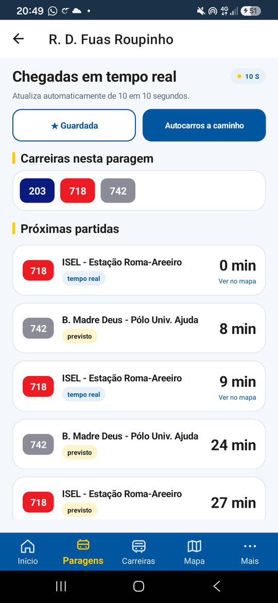
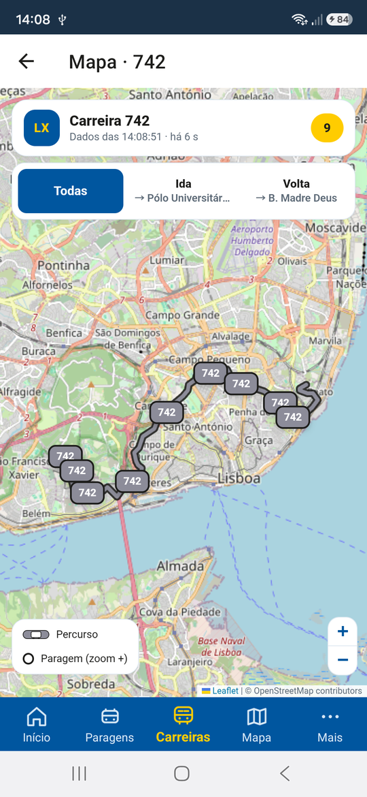
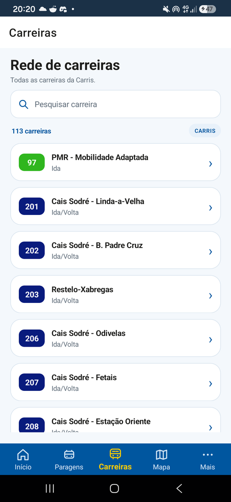

<p align="center">
  
</p>

<h1 align="center">BusLX</h1>

<p align="center">
  <strong>Lisboa em movimento, no teu bolso.</strong><br>
  App Android open source para consultar os autocarros da Carris em tempo real.
</p>

<p align="center">
  
  
  
  
</p>

> **BusLX** é uma app Android open source, feita em .NET MAUI, para ver os
> autocarros da Carris em tempo real. Paragens, carreiras, favoritos e um mapa
> ao vivo, com dados públicos GTFS/GTFS-RT e **sem servidor próprio**.

> **Para usar a app basta a APK.** Não precisas de servidor local, backend,
> conta ou computador ligado. A base de horários vai dentro do APK; só as
> posições em tempo real precisam de internet.

<p align="center">
  
  
  
</p>

<p align="center"><em>Início, chegadas em tempo real e mapa da rede.</em></p>

## Porquê o BusLX?

- **Chegadas em tempo real.** As posições dos autocarros vêm diretamente do
  feed GTFS-RT público da Carris. As previsões teóricas aparecem identificadas
  como **previsto**, para não as confundir com veículos confirmados.
- **Mapa ao vivo.** Toda a rede num só ecrã, com filtros por carreira e sentido,
  percursos coloridos, autocarros clicáveis e foco numa paragem ou veículo.
- **Favoritos que ficam no telemóvel.** Guarda paragens e carreiras; os dados
  são locais e não precisas de criar conta.
- **Cores oficiais da Carris.** Números, linhas, autocarros e legenda usam a cor
  de cada carreira. As carreiras de bairro mantêm o badge amarelo.
- **Leve por dentro.** A base GTFS está pré-processada dentro do APK e o mapa
  foi desenhado para ser fluido em telemóveis modestos.
- **Sem backend, sem tracking.** Não há servidor intermédio, chaves privadas,
  contas ou publicidade.

## Dados: direto da Carris, sem servidor

A app usa apenas os feeds **públicos** da Carris:

- **GTFS estático** — rotas, paragens, horários e formas das carreiras, incluído
  no APK em `src/CarrisRebuild/Resources/Raw/gtfs.db.gz` (≈38 MiB; 113
  carreiras, 2 346 paragens e cerca de 2,47 milhões de `stop_times`). O
  ficheiro não é versionado no Git; descarrega-o da Release com
  `./scripts/fetch-gtfs.sh` antes de compilar.
- **GTFS-RT** — posições dos veículos pedidas diretamente a
  `gateway.carris.pt`, a cada 5 segundos. O feed público muda
  aproximadamente a cada 20 segundos; posições com mais de 5 minutos são
  descartadas.

Não existe API JSON proprietária, `adb reverse`, servidor local ou chave da
Google Maps. O mapa usa **Leaflet + OpenStreetMap/CARTO** e é empacotado no APK.

## Mapa pensado para ser leve

- Com o mapa afastado, os autocarros são desenhados num único canvas, em vez de
  criar um marcador DOM por veículo.
- Os badges com o número da carreira só são materializados perto do viewport.
- As paragens aparecem a partir do zoom 14 e são criadas de forma incremental.
- O mapa recebe um payload compacto e não é atualizado quando o feed não muda.
- A legenda integra o ícone do autocarro na linha colorida de cada carreira.
- No modo **A caminho**, a paragem de destino fica amarela no mapa e na legenda.

## Cores oficiais

O campo `routes.color` do GTFS da Carris está vazio. O catálogo local
`src/CarrisRebuild/Services/RouteColors.cs` reúne as cores oficiais publicadas:

| Cor | Hex | Uso |
| --- | --- | --- |
| Amarelo | `#FFDC00` | Badge das carreiras de bairro |
| Magenta | `#EC008C` | 15E, 18E e associadas |
| Azul | `#00AEEF` | Linhas urbanas e bairros azuis |
| Verde | `#2FB61E` | Linhas verdes; fallback da 97 |
| Vermelho | `#ED1C24` | Linhas vermelhas |
| Laranja | `#F7941E` | Elevadores, elétricos e linhas laranja |
| Cinzento | `#8C8C99` | 701/703/720/727/728/738/742/750/753/756/767 |
| Azul-noite | `#091B7D` | Carreiras noturnas 201–210 |

Os números usam texto branco; o badge amarelo dos bairros usa texto escuro para
manter a legibilidade. A identidade BusLX usa azul `#00569F`, amarelo `#FFCC00`
e tinta `#1D1D1B`.

<p align="center">
  
</p>

<p align="center"><em>Carreiras e cores oficiais no mesmo ecrã.</em></p>

## Release atual

- **Versão:** `1.1` (versionCode `2`)
- **Pacote:** `pt.vialx.app`
- **Arquitetura:** `arm64-v8a`
- **SHA-256 da APK:** `2afa62ea8ce6e989551930c128f6148bd35ba95ee6dc2c9fa54088015ed7afba`
- **Base GTFS:** `gtfs.db.gz` também disponível nos assets da Release

## Instalar

1. Descarrega a APK mais recente na secção **Releases** deste repositório.
2. Autoriza a instalação de apps de fontes desconhecidas, se o Android pedir.
3. Abre o **BusLX**. Na primeira execução, a app prepara a base local de
   horários; nas seguintes arranca mais depressa.

A APK é `arm64-v8a` e foi pensada para telemóveis Android modernos.

## Correr localmente

Pré-requisitos: .NET 8 SDK, workload `maui-android`, Android SDK 34 e JDK 17.

Antes do primeiro build, descarrega a base GTFS (≈38 MiB) a partir dos assets
da Release:

```sh
./scripts/fetch-gtfs.sh
```

O script valida o SHA-256 do ficheiro. Depois:

```sh
dotnet workload install maui-android
dotnet build src/CarrisRebuild/CarrisRebuild.csproj \
  -f net8.0-android -c Debug \
  -p:RuntimeIdentifier=android-arm64
```

APK de desenvolvimento:

```text
src/CarrisRebuild/bin/Debug/net8.0-android/android-arm64/pt.vialx.app-Signed.apk
```

APK Release, só ARM64:

```sh
dotnet publish src/CarrisRebuild/CarrisRebuild.csproj \
  -f net8.0-android -c Release \
  -p:RuntimeIdentifier=android-arm64 \
  -p:AndroidPackageFormat=apk \
  -p:AndroidKeyStore=false
```

```text
src/CarrisRebuild/bin/Release/net8.0-android/android-arm64/publish/pt.vialx.app-Signed.apk
```

Instalar por USB:

```sh
adb install --no-incremental -r \
  src/CarrisRebuild/bin/Release/net8.0-android/android-arm64/publish/pt.vialx.app-Signed.apk
```

> **Nota:** sem `-p:RuntimeIdentifier=android-arm64`, o build pode falhar com
> `XABLD7009: Assembly list for ABI 'x86'...`.

## Estrutura

```text
src/CarrisRebuild/
├── Pages/                    # Início, paragens, carreiras, mapa, detalhe
├── Services/
│   ├── LocalGtfsStore*.cs    # Base GTFS local, consultas e estimativas
│   ├── GtfsRealtime*.cs      # Cliente e parser GTFS-RT
│   ├── LocalCarrisApi.cs     # API local usada pelas páginas
│   └── RouteColors.cs        # Cores oficiais das carreiras
├── Resources/Raw/
│   ├── gtfs.db.gz            # Base estática (descarregada da Release)
│   └── map.html              # Mapa Leaflet, veículos, percursos e legenda
└── Platforms/Android/        # Manifesto, ícone e arranque Android

docs/screenshots/             # Imagens usadas neste README
dist/                         # APK local (não versionada)
```

As pastas `server/` e `site/` contêm uma implementação de referência antiga;
a app Android atual não depende delas.

## Licença

Distribuído sob a **licença MIT**. Consulta [LICENSE](LICENSE).

Copyright (c) 2026 **Diogo Aguiar**. Se reutilizares o projeto ou partes dele,
mantém o aviso de copyright e a licença.

A licença MIT aplica-se ao código deste repositório. Os dados GTFS/GTFS-RT
pertencem à Carris e o mapa usa dados da OpenStreetMap/CARTO; consulta os
respetivos termos de utilização.

## Independência

Projeto independente, sem afiliação com a Carris. Os dados são públicos e
pertencem aos seus autores. O mapa usa OpenStreetMap e CARTO; os respetivos
créditos aparecem no mapa.

## Contribuir

Issues e pull requests são bem-vindos. Mantém o espírito do projeto: leve,
simples, sem backend e com dados públicos.

---

<p align="center">Feito com ❤️ em Lisboa por <strong>Diogo Aguiar</strong>.</p>
